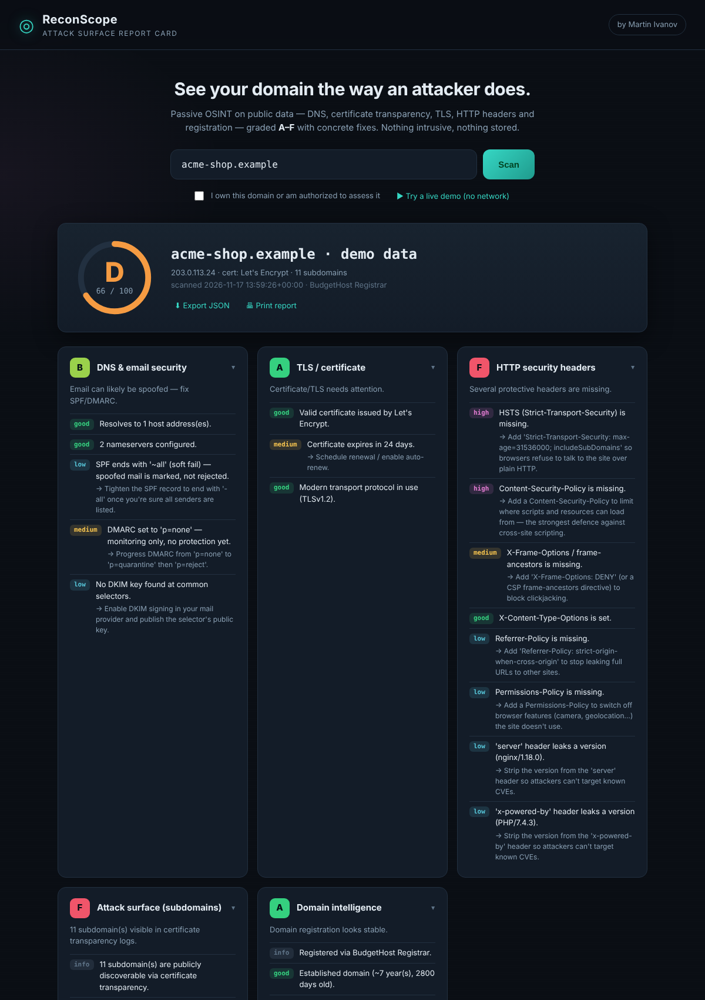
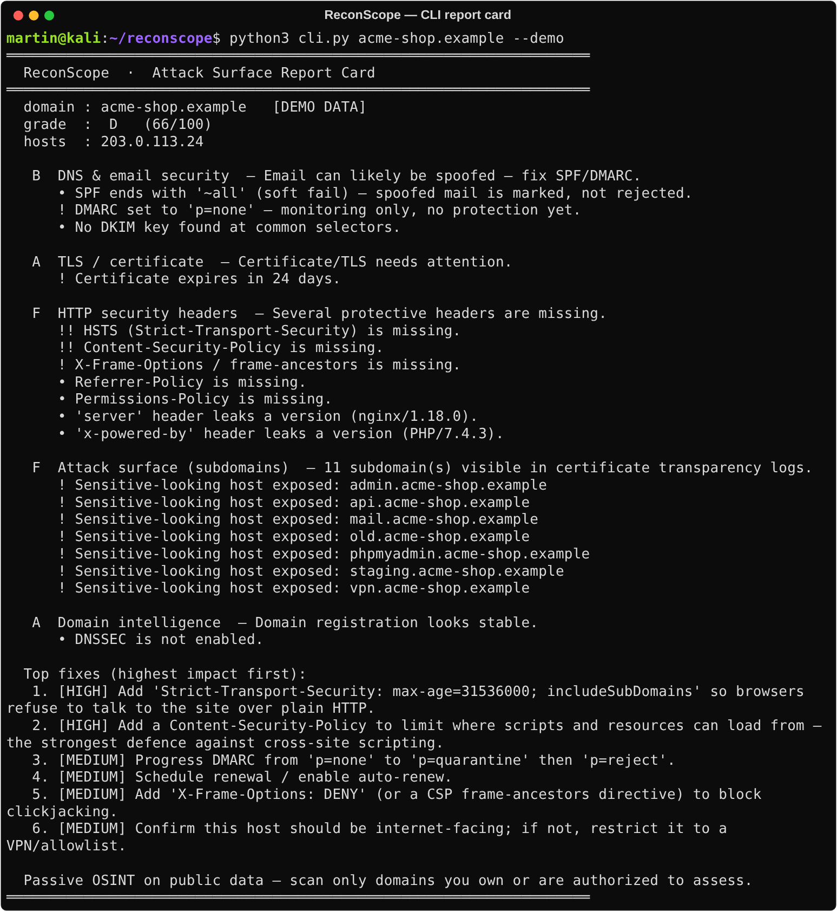
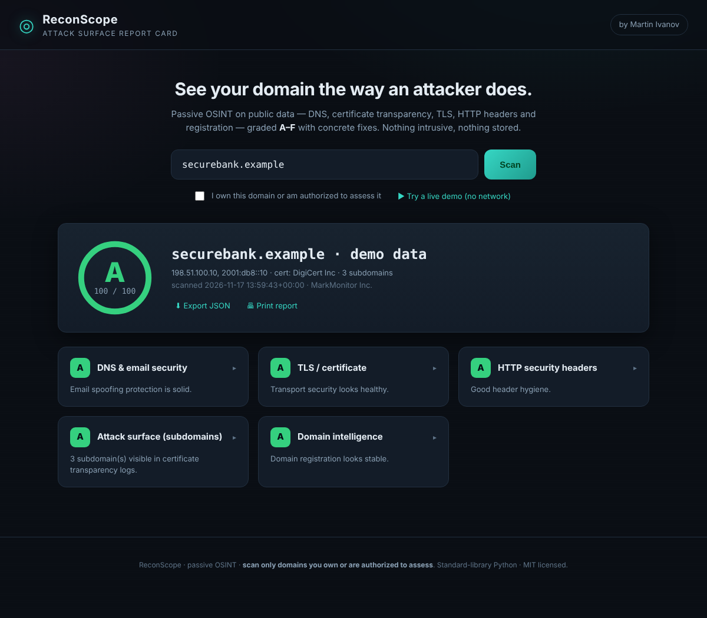

<div align="center">

# ◎ ReconScope

### Attack Surface Report Card

**See your domain the way an attacker does — graded A–F, with the fixes.**
Passive OSINT on public data, a clean local web GUI, zero dependencies.




</div>

---

## 📖 What it is

Enter a domain and ReconScope shows you **how exposed you look from the outside** — the same
footprint a real attacker enumerates before a phishing campaign or a breach. It only ever touches
**public data** (DNS, certificate-transparency logs, the TLS handshake, HTTP response headers, and
public registration records), scores five categories, and hands you a prioritised list of fixes.

It's the defender's mirror of reconnaissance: the point isn't to attack anyone, it's to find the holes
in **your own** surface before someone else does. This is the market "attack surface management"
companies (Detectify, Censys, Security Scorecard) built — ReconScope puts a friendly, local,
dependency-free version of it on your laptop.

> **Ethics:** ReconScope is passive and non-intrusive — no port scanning, no exploitation, no logins.
> Still, only scan domains **you own or are explicitly authorised to assess**. The GUI asks you to
> confirm this before every live scan.

## ✨ What it grades

| Category | What it inspects |
|---|---|
| **DNS & email security** | A/AAAA/MX/NS records, and the anti-spoofing trio **SPF · DKIM · DMARC** (presence *and* strictness) |
| **TLS / certificate** | Certificate validity, issuer, days-to-expiry, negotiated protocol version |
| **HTTP security headers** | HSTS, CSP, X-Frame-Options, X-Content-Type-Options, Referrer-Policy, Permissions-Policy, version leaks |
| **Attack surface** | Subdomains discoverable in **certificate-transparency logs**, flagging admin/dev/vpn/db-style hosts |
| **Domain intelligence** | Registrar, domain age, expiry, DNSSEC |

Each category gets a letter grade; the overall grade is a weighted roll-up (email spoofing and TLS
count the most). Every failing check comes with a concrete, copy-pasteable fix.

## 🖥️ Two ways to run it

**A polished local web GUI** — grade dial, colour-coded category cards, expandable findings, JSON
export and a print-to-PDF report:

```bash
python3 cli.py --serve      # opens http://127.0.0.1:8787 in your browser
```

**A CLI** for scripts, pipelines and quick checks:



<table>
<tr>
<td width="50%"><b>Weak domain → D</b><br></td>
<td width="50%"><b>Hardened domain → A</b><br></td>
</tr>
</table>

---

## 🚀 Tutorial

### 1. Get it (no install, no dependencies — just Python 3.8+)

```bash
git clone https://github.com/Martun1/reconscope.git
cd reconscope
python3 cli.py securebank.example --demo      # offline sample, see it work instantly
```

### 2. Launch the GUI

```bash
python3 cli.py --serve
```

Your browser opens the dashboard. Type a domain, tick **"I own this domain or am authorized to
assess it"**, and hit **Scan**. Or click **Try a live demo** to see a full report with no network.

### 3. Scan from the command line

```bash
python3 cli.py example.com                 # report card
python3 cli.py example.com --json          # machine-readable
python3 cli.py example.com --verbose       # show passing checks too
```

The exit code reflects posture (**0** = A/B, **1** = C/D, **2** = F), so it drops straight into CI:

```bash
python3 cli.py yourdomain.com || echo "posture slipped — investigate"
```

> 💡 **На български:** въведи домейн, който притежаваш, и ReconScope ти дава оценка A–F по пет
> категории плюс конкретни стъпки за поправка. Всичко е пасивно — само публични данни, нищо не се
> напада и нищо не се пази. За офлайн демо: `python3 cli.py --serve` и натисни *Try a live demo*.

---

## 🧠 How it works

ReconScope fans five passive collectors out across threads, so a full scan is as fast as the slowest
single lookup:

- **DNS over HTTPS** (Google / Cloudflare JSON APIs) for A/MX/NS/TXT, `_dmarc`, and common DKIM selectors
- **crt.sh** certificate-transparency search for subdomains nobody advertised
- a raw **TLS handshake** to read the live certificate and protocol
- one **HTTPS GET** to inspect response headers
- **RDAP** (the modern WHOIS) for registrar, age, expiry and DNSSEC

Each raw result is handed to a pure, network-free analyser (`reconscope/checks.py`) that decides what's
good, what's risky and how to fix it. A transparent scoring model (`scoring.py`) — every category starts
at 100 and loses points by severity — produces the grades. Because the analysis is separated from the
fetching, the whole judgement layer is unit-tested offline with fixtures, and the `--demo` mode runs the
entire pipeline with no network at all.

## 🧱 Project structure

```
reconscope/
├── cli.py                     # CLI + launches the GUI
├── reconscope/
│   ├── fetchers.py            # passive collectors (DoH, crt.sh, TLS, headers, RDAP)
│   ├── checks.py              # pure analysers → graded categories
│   ├── scoring.py             # severity model + overall grade
│   ├── engine.py              # concurrent orchestration
│   ├── server.py              # stdlib web server for the GUI
│   └── demo.py                # offline sample data
├── web/                       # the GUI (index.html · style.css · app.js)
├── tests/test_reconscope.py   # 18 offline tests
└── .github/workflows/ci.yml   # Linux · Windows · macOS × Py 3.8/3.10/3.12
```

## 🗺️ Roadmap

- [ ] HaveIBeenPwned breach-by-domain lookup (opt-in, API key)
- [ ] Open-port surface check via Shodan/Censys InternetDB (passive, no scanning)
- [ ] Scheduled re-scans with diff alerts ("a new admin subdomain appeared")
- [ ] PDF export of the report card
- [ ] Watchlist: track several domains on one dashboard

## ⚖️ Legal & ethics

ReconScope performs only passive reconnaissance over publicly available data and sends no intrusive
traffic to the target. You are responsible for using it lawfully — scan only assets you own or are
authorised to assess. Provided as-is under the MIT License.

---

<div align="center">
Made by <a href="https://github.com/Martun1">Martin Ivanov</a> · eJPT · CCNA · Computer Science @ NBU
</div>
